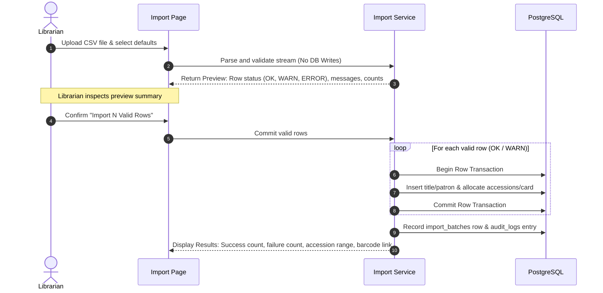

# RBMI Library Management System — CSV Import Specification

This document provides the definitive data format, validation rules, encoding handlers, and execution workflow for bulk CSV imports across the RBMI Library Management System, derived from Sections 4.4, 4.6, 6.2, 7.1, 7.3, and Appendix 10.1 of the SRS.

---

## 1. Universal CSV Parsing & File Handling Rules

1. **Standard Compliance:** All files parsed per **RFC 4180** using `csv-parse`.
2. **Character Encodings:**
   - Supported encodings: **UTF-8** (with or without BOM) and **Windows-1252** (decoded using `iconv-lite`).
   - UTF-8 Byte Order Marks (`0xEF, 0xBB, 0xBF`) are stripped prior to parsing.
3. **Header Row:**
   - The first line must contain column headers.
   - Header matching is **case-insensitive**.
   - Whitespace and punctuation in headers are normalised to underscores (e.g., `Roll Number` $\to$ `roll_number`).
4. **Column Tolerances:**
   - Unknown/unmapped columns are silently ignored.
   - Empty or whitespace-only rows are skipped.
5. **Date Formats Accepted:**
   - `dd-mm-yyyy` (e.g., `15-08-2026`)
   - `dd/mm/yyyy` (e.g., `15/08/2026`)
   - `yyyy-mm-dd` (e.g., `2026-08-15`)
6. **Text Limits & Truncation (DR-05):** Text fields exceeding database limits (e.g., title $\gt 500$, address $\gt 500$, names $\gt 60$) must be **automatically truncated** rather than failing the row.
7. **File Size Limits (NFR-P-03):** Patron CSV files up to **10 MB**; Book CSV files up to **20 MB**. Processing throughput $\ge 100$ rows per second.

---

## 2. Book Catalogue Import Specification (Appendix 10.1, FR-BI-01 to 05)

Each CSV row represents **one title plus one or more physical copies**.

### 2.1 Field Mappings & Validations

| Column | Required? | Accepted Aliases | Validation / Fallback Rules | DB Field / Target |
| :--- | :---: | :--- | :--- | :--- |
| `title` | **YES** | — | String $\le 500$ chars. Missing $\to$ **ERROR** (row skipped). | `bib_records.title` |
| `isbn` | NO | — | Hyphens, spaces, and punctuation stripped. If matches existing normalized ISBN $\to$ add copies to existing title (WARN/INFO). If not 10 or 13 digits $\to$ **WARN**, retained. | `bib_records.isbn` |
| `subtitle` | NO | — | Free text, truncated to 500 chars. | `bib_records.subtitle` |
| `authors` | NO | `author` | Free text, truncated to 500 chars. Default: `'Unknown'` if title is new. | `bib_records.authors` |
| `editors` | NO | `editor` | Free text, truncated to 500 chars. | `bib_records.editors` |
| `edition` | NO | — | Free text $\le 50$ chars. | `bib_records.edition` |
| `publisher`| NO | — | Free text, truncated to 200 chars. | `bib_records.publisher` |
| `place` | NO | `place_of_publication` | Free text, truncated to 100 chars. | `bib_records.place_of_publication` |
| `pub_year` | NO | `year`, `publication_year` | Integer between `1500` and `(current_year + 1)`. Outside range $\to$ **WARN**, set null. | `bib_records.pub_year` |
| `pages` | NO | — | Free text $\le 50$ chars. | `bib_records.pages` |
| `language` | NO | — | Free text $\le 50$ chars. Default: `'English'`. | `bib_records.language` |
| `subject` | NO | — | Free text, truncated to 500 chars. | `bib_records.subject` |
| `keywords` | NO | — | Free text, truncated to 500 chars. | `bib_records.keywords` |
| `ddc` | NO | `ddc_number` | Free text $\le 50$ chars. | `bib_records.ddc_number` |
| `call_number`| NO | `call_no` | Free text $\le 100$ chars. | `bib_records.call_number` |
| `summary` | NO | — | Free text, truncated to 4000 chars. | `bib_records.summary` |
| `item_type`| NO | `type` | Code matching `item_types.code`. Default: `'GEN'` / `'BOOK'`. Unknown code $\to$ **ERROR**. | `bib_records.item_type_id` |
| `department`| NO | `dept` | Code matching `departments.code`. Unknown code $\to$ **WARN**, set null. | `bib_records.department_id` |
| `library` | NO | — | Code matching `libraries.code`. Default: library selected in upload UI. Unknown code $\to$ **ERROR**. | `items.library_id` |
| `copies` | NO | `qty`, `quantity`, `no_of_copies` | Integer between $0$ and $500$. Default: $1$. | Quantity of items created |
| `accession_no`| NO | `accession`, `accession_number` | Pipe-delimited list (e.g. `CL001\|CL002`). Count must equal `copies`. Must be unique in DB and file. Missing $\to$ auto-generated. Duplicate $\to$ **ERROR**. | `items.accession_no` |
| `barcode` | NO | — | Pipe-delimited list. Defaults to accession number. Duplicate $\to$ **ERROR**. | `items.barcode` |
| `price` | NO | `rate`, `cost` | Numeric $\ge 0.00$. Invalid number $\to$ **WARN**, set $0.00$. | `bib_records.price`, `items.price` |
| `vendor` | NO | — | Vendor name matching `vendors.name`. Unknown $\to$ **WARN**, set null. | `items.vendor_id` |
| `invoice_no`| NO | — | Free text $\le 100$ chars. | `items.invoice_no` |
| `acquisition_date`| NO | — | Valid date. Default: today. | `items.acquisition_date` |
| `location` | NO | — | Free text $\le 100$ chars. | `items.location` |

---

## 3. Student Patron Import Specification (Appendix 10.1, FR-PI-01 to 05)

### 3.1 Field Mappings & Validations

| Column | Required? | Accepted Aliases | Validation / Fallback Rules | DB Field / Target |
| :--- | :---: | :--- | :--- | :--- |
| `roll_no` | **YES** | `roll_number`, `roll`, `university_roll_no` | String $\le 50$. Must be unique in DB and file. Missing or existing $\to$ **ERROR** (row skipped). | `patrons.roll_no` |
| `first_name`| **YES** | — | String $\le 60$. Missing $\to$ **ERROR** (row skipped). If combined `name` provided, split into first/middle/last. | `patrons.first_name` |
| `middle_name`| NO | — | String $\le 60$. | `patrons.middle_name` |
| `last_name` | NO | — | String $\le 60$. | `patrons.last_name` |
| `enrollment_no`| NO | `enrollment_number` | String $\le 50$. | Internal note / metadata |
| `card_no` | NO | `card_number`, `library_card_no` | String $\le 50$. Default: equals `roll_no`. Must be unique in DB and file. | `patrons.card_no` (and `username`) |
| `gender` | NO | — | M/F/O (or Male/Female/Other normalized). | `patrons.gender` |
| `dob` | NO | `date_of_birth` | Valid date string. | `patrons.dob` |
| `institute` | NO | `institution`, `college` | Matches `institutions.code`. Unknown $\to$ **WARN**, set null. | `patrons.institution_id` |
| `course` | NO | — | Matches `courses.code`. Unknown $\to$ **WARN**, set null. | `patrons.course_id` |
| `department`| NO | `branch`, `dept` | Matches `departments.code`. Unknown $\to$ **WARN**, set null. | `patrons.department_id` |
| `year` | NO | — | Integer (1..5). | `patrons.academic_year` |
| `semester` | NO | `sem` | Integer (1..10). | `patrons.semester` |
| `section` | NO | — | String $\le 10$. | `patrons.section` |
| `category` | NO | — | Matches `patron_categories.code`. Default: category selected in upload UI. Unknown code $\to$ **ERROR**. | `patrons.category_id` |
| `father_name`| NO | `fathers_name` | String $\le 100$. | `patrons.father_name` |
| `mobile` | NO | `phone`, `mobile_no`, `contact` | Digits kept, `+91` stripped. If not 10 digits $\to$ **WARN**, retained. | `patrons.mobile` |
| `email` | NO | `email_id` | Email format check. Invalid or duplicated $\to$ **WARN**, retained. | `patrons.email` |
| `address` | NO | — | Free text, truncated to 500 chars. | `patrons.address` |
| `admission_date`| NO | — | Valid date. Default: today. | `patrons.admission_date` |
| `course_end_date`| NO | — | Valid date. Used for `card_expiry`. | `patrons.course_end_date` |
| `password` | NO | — | Plaintext initial password. Default: equals `card_no`. Hashed via Argon2id. `must_change_password` set `true`. | `patrons.password_hash` |

---

## 4. Faculty / Staff Patron Import Specification (Appendix 10.1)

Follows the student import rules with the following differences:
- `employee_id` is **REQUIRED** (aliases: `emp_id`, `employee_code`). Must be unique in DB and file. Missing or duplicate $\to$ **ERROR**.
- `card_no` defaults to `employee_id`.
- `category` must resolve to a category with `patron_type IN ('FACULTY', 'STAFF')`.
- `joining_date` (aliases: `date_of_joining`, `doj`) mapped to `admission_date`.
- `card_expiry` calculated as `joining_date (or today) + category.card_validity_years`.
- Initial OPAC password defaults to `card_no` (`employee_id`).

---

## 5. Two-Stage Execution Lifecycle (Flow Diagram Page 5)

### 5.1 Stage 1: Validation and Preview (`FR-PI-02`, `FR-BI-02`)
- **Zero Database Writes:** Nothing is written to the persistent schema during upload.
- **Classification:** Every row is classified into one of three statuses:
  - `OK`: All fields valid and mapped without warnings.
  - `WARN`: Minor discrepancies present (e.g. unknown department set blank, invalid phone retained, existing ISBN adds copies). The row is eligible for import.
  - `ERROR`: Fatal violation (e.g. missing required field, unknown item type, duplicate roll number/accession number). Row will be skipped.
- **UI Presentation:** Displays total rows, OK count, WARN count, ERROR count, and a preview table with per-row messages. For books, each row indicates whether it creates a new title or adds copies to an existing title (`FR-BI-03`).

### 5.2 Stage 2: Confirmation & Independent Row Transactions (`FR-PI-04`, `FR-BI-05`, `NFR-R-02`)
- **Per-Row Transactional Isolation:** Each valid row (`OK` and `WARN`) is committed within its own isolated transaction (`db.transaction`). If a row fails at insertion (e.g. unexpected constraint failure), only that row rolls back; all subsequent and previous rows remain intact (`NFR-R-02`).
- **Batch Record:** Upon completion, a row is written to `import_batches` recording `import_type`, `file_name`, `total_rows`, `imported_rows`, `skipped_rows`, and `imported_by`.
- **Audit:** An append-only audit entry `IMPORT` is written to `audit_logs`.
- **Deduplication (`FR-PI-05`, `T-19`):** Re-importing the same CSV file immediately flags existing unique keys (`roll_no`, `employee_id`, `accession_no`) as duplicate errors and creates zero new rows.
