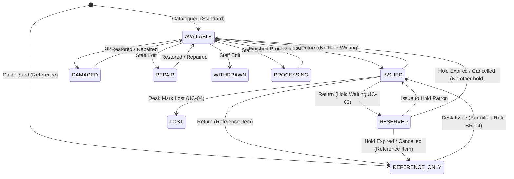
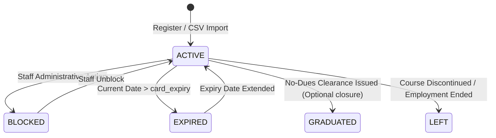
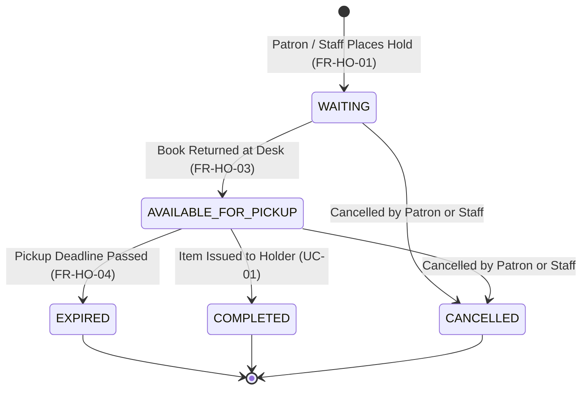
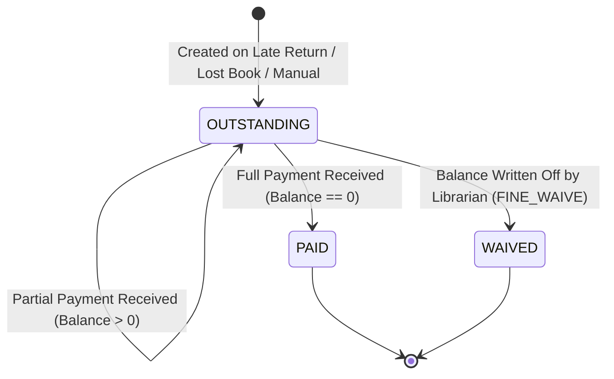

# RBMI Library Management System — Status Transitions Specification

This document defines all valid entity lifecycle statuses, permitted state transitions, guard conditions, and mutation side effects across the RBMI Library Management System, derived from Sections 4, 5, 6, and 10 of the SRS.

---

## 1. Glossary of All Status Codes (SRS Section 10.6)

| Entity | Allowed Status Codes | Default Initial State | Immutability / Retention Rule |
| :--- | :--- | :--- | :--- |
| **Patron** | `ACTIVE`, `BLOCKED`, `EXPIRED`, `GRADUATED`, `LEFT` | `ACTIVE` | Retained indefinitely; never physically deleted (`FR-PA-08`, `DR-06`). |
| **Item (Copy)** | `AVAILABLE`, `ISSUED`, `RESERVED`, `REFERENCE_ONLY`, `LOST`, `DAMAGED`, `REPAIR`, `WITHDRAWN`, `PROCESSING` | `AVAILABLE` (or `REFERENCE_ONLY` if reference item) | Retained indefinitely; `WITHDRAWN` copies remain in accession register (`FR-CA-08`). |
| **Loan** | `ISSUED`, `RETURNED`, `LOST` | `ISSUED` | Retained indefinitely; never physically deleted (`DR-06`). |
| **Hold** | `WAITING`, `AVAILABLE_FOR_PICKUP`, `COMPLETED`, `EXPIRED`, `CANCELLED` | `WAITING` | Retained indefinitely; history kept for audit and analytics. |
| **Fine** | `OUTSTANDING`, `PAID`, `WAIVED` | `OUTSTANDING` | Retained indefinitely; never edited or physically deleted (`FR-FI-05`). |
| **Fine Types** | `OVERDUE`, `LOST`, `DAMAGE`, `MANUAL` | — | Set at creation; immutable. |
| **Payment Methods**| `CASH`, `UPI`, `CARD`, `ONLINE`, `WAIVED` | — | Set at receipt generation; immutable. |
| **Staff User** | `true` (Active), `false` (Inactive) | `true` | Retained indefinitely; never physically deleted (`DR-02`). |

---

## 2. Copy (Item) Lifecycle & Status Transitions (Section 5.3)

### 2.1 Desk vs. Administrative Transition Boundaries
- **Desk Privilege:** Only circulation desk transactions (`CIRC_ISSUE`, `CIRC_RETURN`, `CIRC_LOST`, hold pickup) may transition copies between `AVAILABLE`, `ISSUED`, and `RESERVED`.
- **Administrative Privilege:** Staff with `CATALOG_MANAGE` may transition any copy that is **not currently `ISSUED` or `RESERVED`** into an administrative status (`LOST`, `DAMAGED`, `REPAIR`, `WITHDRAWN`, `PROCESSING`) and restore it back to `AVAILABLE` (or `REFERENCE_ONLY`).
- **Reference Integrity:** Copies marked as reference item types (`item_types.is_reference == true`) always return to `REFERENCE_ONLY`, never to `AVAILABLE`.

### 2.2 Complete Copy Transition Matrix

| Source State | Target State | Triggering Operation | Actor / Permission | Guard Conditions | Side Effects |
| :--- | :--- | :--- | :--- | :--- | :--- |
| *New* | `AVAILABLE` | Add Title / Copy (`FR-CA-02`) | Staff (`CATALOG_MANAGE`) | Item type `is_reference == false` | Accession number allocated. |
| *New* | `REFERENCE_ONLY` | Add Title / Copy (`FR-CA-06`) | Staff (`CATALOG_MANAGE`) | Item type `is_reference == true` | Accession number allocated. |
| `AVAILABLE` | `ISSUED` | Desk Checkout (`FR-CI-02`) | Librarian (`CIRC_ISSUE`) | Pass all 9 issue checks (BR-02–09) | `loans` row created; audit `ISSUE`. |
| `REFERENCE_ONLY` | `ISSUED` | Desk Checkout (`FR-CI-02`) | Librarian (`CIRC_ISSUE`) | Winning rule explicitly names item type (`BR-04`) | `loans` row created; audit `ISSUE`. |
| `RESERVED` | `ISSUED` | Desk Checkout (`FR-CI-02`) | Librarian (`CIRC_ISSUE`) | Scanned patron matches hold patron | `holds` status $\to$ `COMPLETED`; `loans` row created; audit `ISSUE`. |
| `ISSUED` | `AVAILABLE` | Desk Check-in (`FR-CI-03`) | Librarian (`CIRC_RETURN`)| No waiting holds; item not reference | `loans` status $\to$ `RETURNED`; late fine created if applicable; audit `RETURN`. |
| `ISSUED` | `REFERENCE_ONLY`| Desk Check-in (`FR-CI-03`) | Librarian (`CIRC_RETURN`)| No waiting holds; item is reference | `loans` status $\to$ `RETURNED`; late fine created if applicable; audit `RETURN`. |
| `ISSUED` | `RESERVED` | Desk Check-in (`FR-CI-03`) | Librarian (`CIRC_RETURN`)| A hold is `WAITING` for this title | First hold $\to$ `AVAILABLE_FOR_PICKUP`; pickup deadline set; desk alert to hold item aside. |
| `ISSUED` | `LOST` | Mark Lost (`FR-CI-05`) | Librarian (`CIRC_LOST`) | Loan is active | `loans` status $\to$ `LOST`; `fines` (LOST) created; audit `CIRC_LOST`. |
| `RESERVED` | `AVAILABLE` / `REFERENCE_ONLY` | Hold Expiry or Cancellation (`FR-HO-04`) | System / Librarian (`HOLD_MANAGE`) | No remaining waiting holds for this title | Hold status $\to$ `EXPIRED` or `CANCELLED`. |
| `AVAILABLE` | `DAMAGED` / `REPAIR` / `WITHDRAWN` | Administrative Status Change | Staff (`CATALOG_MANAGE`) | Item not currently on loan or held | Item removed from active stock counts; audit `CATALOG_EDIT`. |
| `DAMAGED` / `REPAIR` | `AVAILABLE` / `REFERENCE_ONLY` | Administrative Restoration | Staff (`CATALOG_MANAGE`) | Item repaired / restored | Item returned to circulating stock. |

---

## 3. Patron Lifecycle & Borrowing Eligibility (Section 5.4)

### 3.1 Patron State Machine

### 3.2 Patron State Rules

| Patron Status | Can Search OPAC? | Can Login OPAC? | Can Place Holds? | Can Borrow Books? | Transition Triggers |
| :---: | :---: | :---: | :---: | :---: | :--- |
| `ACTIVE` | **YES** | **YES** | **YES** (if card not expired) | **YES** (subject to BR-08 checks) | Initial status upon registration or bulk import. |
| `BLOCKED` | **YES** | NO | NO | NO | Staff manually blocks patron due to disciplinary or administrative hold. |
| `EXPIRED` | **YES** | NO | NO | NO | Automatically enforced when `today > card_expiry`. Card renewal extends date. |
| `GRADUATED` | **YES** | NO | NO | NO | Set upon No-Dues clearance certificate issue (`FR-ND-02`). Account permanently closed. |
| `LEFT` | **YES** | NO | NO | NO | Staff marks patron withdrawn before graduation. |

---

## 4. Hold (Reservation) Lifecycle & Transitions (Section 4.8, 5.4)

### 4.1 Hold State Machine

### 4.2 Hold State Transitions

| Current State | Target State | Trigger | Actor | Guard Conditions | Side Effects |
| :--- | :--- | :--- | :--- | :--- | :--- |
| *None* | `WAITING` | Reserve Title (`FR-HO-01`) | Patron / Staff | No copy `AVAILABLE`; patron `ACTIVE`; no duplicate hold; holds allowed | Queue position calculated; audit `HOLD_CREATE`. |
| `WAITING` | `AVAILABLE_FOR_PICKUP` | Return Copy (`FR-HO-03`)| Desk Check-in | Oldest waiting hold for returned title | `item.status = 'RESERVED'`; `expiry_date = today + HOLD_PICKUP_DAYS`. |
| `AVAILABLE_FOR_PICKUP`| `COMPLETED` | Desk Issue (`FR-CI-02`)| Desk Checkout | Patron matches hold recipient | `item.status = 'ISSUED'`; audit `HOLD_FULFILL`. |
| `AVAILABLE_FOR_PICKUP`| `EXPIRED` | Dashboard / Page Load (`FR-HO-04`)| System Housekeeping | `today > hold.expiry_date` | Held item passed to next waiting hold or released to `AVAILABLE`/`REFERENCE_ONLY`. |
| `WAITING` or `AVAILABLE_FOR_PICKUP` | `CANCELLED` | Cancel Hold (`FR-OP-03`)| Patron / Staff | Request by owning patron or staff | If pickup-ready, held copy passed to next hold or released. |

---

## 5. Fine Lifecycle & Payment Settlement (Section 4.9, 5.4)

### 5.1 Fine State Machine

### 5.2 Fine Transitions & Guard Conditions

| Current State | Target State | Trigger | Actor / Permission | Financial Mutation | Side Effects |
| :--- | :--- | :--- | :--- | :--- | :--- |
| *None* | `OUTSTANDING` | Late Return (`BR-06`) / Mark Lost (`BR-07`) | Circulation Desk | Amount calculated $\gt 0$ | Fine record inserted; balance appears in patron dues. |
| `OUTSTANDING` | `OUTSTANDING` | Partial Payment (`FR-FI-02`) | Staff (`FINE_COLLECT`) | `paid_amount += payment_amount`; `payment_amount < balance` | `payments` record inserted; receipt `RCPT-YYYY-NNNNN` printed; audit `PAYMENT`. |
| `OUTSTANDING` | `PAID` | Full Payment (`FR-FI-02`) | Staff (`FINE_COLLECT`) | `paid_amount = amount` (`balance == 0`) | `payments` record inserted; receipt printed; audit `PAYMENT`. |
| `OUTSTANDING` | `WAIVED` | Fine Waiver (`FR-FI-04`) | Librarian (`FINE_WAIVE`) | Remaining balance forgiven | Waiver `payments` record inserted (method `WAIVED`); waiver receipt printed; audit `FINE_WAIVE`. |
